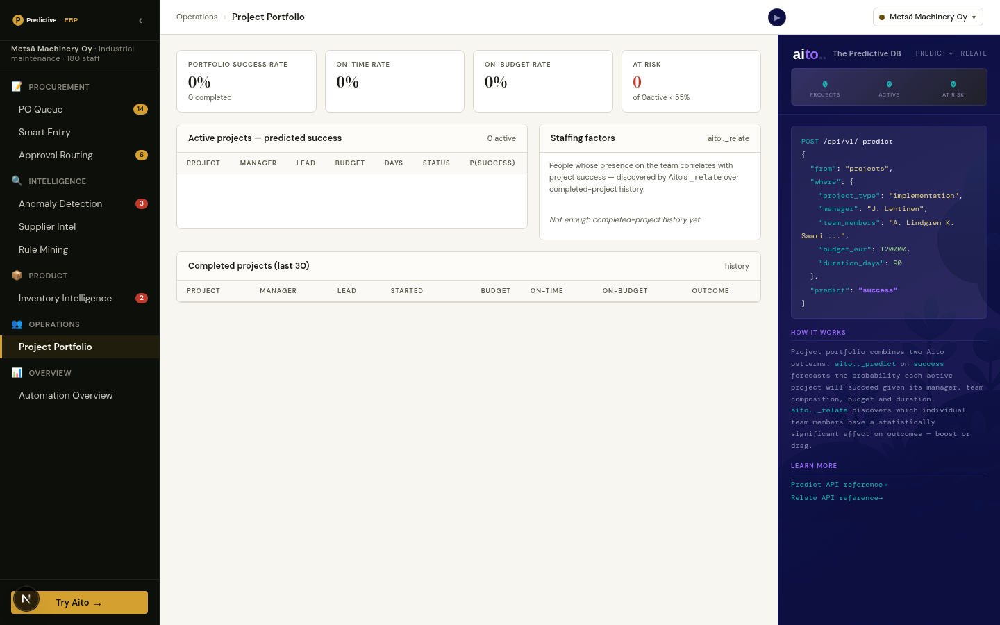

# Use case 12 — Project Portfolio

> Active projects forecast on one KPI at a time: a combined reading of
> the core three, or any of the six outcomes behind it.



## What it does

A selector above the table picks the KPI the whole view examines:
**Combined** (default) or one of six outcomes: makes money, team stays
happy, customer stays happy (was it worth doing), lands when we said, the
thing works, opens a door (did it hold up). The history rate, the
predicted mean over active projects, the at-risk count, the table's
probability column, its `$why` popover and the success factors all follow
the selection (and it lives in the URL as `?kpi=`).

**Combined** is the expected number of the core three that land, over
three. It is read from ONE `_predict` on `outcome_score`, a discrete
column holding how many of money, team and customer landed ("0".."3").
That is the average of the three KPIs, except it comes from a single
prediction that carries the correlation between them, plus the whole
distribution over the four steps. A product of three probabilities was
rejected: it gives a negative view and a very high bar. Selecting a row
also shows every KPI for that project, each its own `_predict` with its
own `$why`; their drivers differ, so a project can be likely to make
money and unlikely to keep the team happy.

A second column lists **success factors**: properties of the work that
move the selected KPI's rate across completed projects (for Combined, the rate of landing all three, `outcome_score = "3"`). These are project type,
priority and the five outcome drivers: contract type, scope clarity,
novelty, customer size and team seniority. They are discovered via
`_relate`, not configured.

The list never names people. It used to relate `assignments.person` and
`projects.manager`, which put named colleagues in a ranked list of what
goes with success. That is a league table of people presented as a
finding, and it isn't one to put on a screen. Who staffs a job well is
the Engagement Planner's question, asked about one candidate at a time.

## Aito query — success forecast

```json
POST /api/v2/_predict
{
  "from": "projects",
  "where": {
    "project_type": "implementation",
    "manager": "J. Lehtinen",
    "team_size": 5,
    "budget_eur": 120000,
    "duration_days": 90,
    "priority": "medium",
    "contract_type": "fixed_price",
    "scope_clarity": "unclear",
    "novelty": "new_stack",
    "customer_size": "mid",
    "team_seniority": "mixed"
  },
  "predict": "success",
  "select": ["$p", "feature", { "$why": {} }]
}
```

The same `where` is sent six more times with `predict` set to
`financial_ok`, `team_happy`, `customer_happy`, `on_time`, `outcome_ok`
and `doors_opened`.

Returns the top hits for `success=true | false` with probabilities and
the full factor tree. The frontend extracts `P(success=true)` and runs
it through `why_processor.py` to produce the highlighted multiplicative
chain.

## Aito query — success factors

One `_relate` per field, each over completed projects:

```json
POST /api/v2/_relate
{
  "from": "projects",
  "where": { "outcome_score": "3" },
  "relate": ["scope_clarity"]
}
```

The fields are `project_type`, `priority`, `contract_type`,
`scope_clarity`, `novelty`, `customer_size` and `team_seniority`. The
hits are merged into one list, sorted by distance from neutral lift. A
lift above 1 boosts the KPI; below 1 drags it. The where is
`{ "<kpi>": true }` for a single outcome. Endpoint:
`GET /api/projects/success-factors?kpi=`. The side panel shows the
exact body sent for whichever factor is selected.

## Schema

```
projects:
  project_id     String   PK
  name           String
  project_type   String   maintenance | implementation | rollout | audit | rd
  customer       String
  manager        String
  team_lead      String
  team_size      Int
  team_members   Text     space-separated names — Aito tokenises so
                          per-person effects become learnable
  budget_eur     Decimal
  duration_days  Int
  priority       String
  status         String   active | at_risk | delayed | complete
  start_month    String
  on_time        Bool?    null until complete
  on_budget      Bool?
  success        Bool?    target field

assignments:
  assignment_id    String  PK
  project_id       String  → projects.project_id
  person           String
  role             String  lead | senior | engineer
  allocation_pct   Int
  project_type     String  denormalised mirror of projects.project_type
  project_success  Bool?   denormalised mirror of projects.success
```

## Tradeoffs / honest notes

- **`team_members` as Text**: tokenisation lets Aito learn per-person
  effects without an array column, but spelling matters. "A. Lindgren"
  and "Anna Lindgren" would look like different people.
- **Confounding**: the staffing-factors lift score reports raw
  correlation. A senior engineer who only takes on simple maintenance
  projects will look like a "boost". This is honest output from
  `_relate`; it's the operator's job to weigh confounders. The page
  notes "treat with care: confounded with project type and seniority".
- **Sample-size guard**: factors with `fOnCondition < 4` are dropped
  to avoid spurious top-list entries.

## Implementation

[`src/project_service.py`](../../src/project_service.py) — three
public functions: `get_portfolio()` (parallel-forecasts every active
project), `forecast_with_override()` (the staffing simulator —
predicts twice with different `team_members`, returns the delta), and
`_staffing_factors_from_relate()`.

The booktest [`tests/test_project_booktest.py`](../../tests/test_project_booktest.py)
validates that the engineered signal is preserved across all three
persona fixtures and (when Aito creds are set) that `_predict` and
`_relate` actually pick that signal up.

## What this demo abstracts away

- **Confounding correction**. The staffing-factors lift score
  reports raw correlation. A senior engineer who only takes simple
  maintenance projects will look like a "boost"; a junior who only
  takes risky greenfields will look like a "drag". Production wants
  per-(person × project_type) lift, which means filtering the
  `_relate` query by project_type — Aito supports it; the demo
  shows the unfiltered version for clarity.
- **Time-series prediction**. The demo predicts current state
  (P(success at completion) for each active project). Production
  wants weekly-trend: how is P(success) moving over time? That
  requires snapshotting `_predict` outputs into a `project_history`
  table on a schedule and serving the trend from there.
- **Project-management tool integration**. Project + assignment
  data here comes from JSON fixtures. Real deployments feed from
  Jira, Asana, MS Project, or in-house PM tools — usually via
  nightly ETL into the `projects` and `assignments` tables. The
  prediction logic is unchanged; the data pipeline isn't shown.
